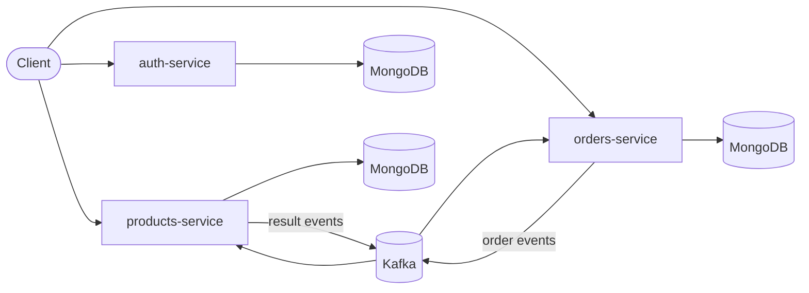

# Benito Ventas - Shop Project

Microservices-based shop backend built with **Quarkus**, **MongoDB** and **Apache Kafka**. It covers users, products and purchase orders, with JWT authentication and asynchronous communication between the products and orders services. Service-to-service traffic is secured with TLS/mTLS.

This is a learning project for the Quarkus + Kafka stack, so some choices follow the framework defaults and guides. Suggestions and corrections are welcome.

## Table of Contents

- [Architecture](#architecture)
- [Services](#services)
- [Order Flow](#order-flow)
- [Data Model](#data-model)
- [Tech Stack](#tech-stack)
- [Prerequisites](#prerequisites)
- [Certificates (TLS / mTLS)](#certificates-tls--mtls)
- [Getting Started](#getting-started)
- [Configuration](#configuration)
- [API Overview](#api-overview)
- [Project Structure](#project-structure)
- [Development](#development)

## Architecture



Each service owns its data and has its own logical MongoDB database. Orders are not processed synchronously: `orders-service` publishes an event to Kafka and `products-service` handles it independently. This keeps the two services decoupled, at the cost of eventual consistency for order status.

## Services

| Service | Responsibility |
|---|---|
| `auth-service` | User registration, login and JWT issuance. Backed by MongoDB. |
| `products-service` | Product catalog and stock management. Consumes order events from Kafka and publishes the result. |
| `orders-service` | Creates orders, publishes them to Kafka and tracks their status. |

## Order Flow

1. The client authenticates against `auth-service` and receives a JWT.
2. The client creates an order in `orders-service`. The order is persisted (initial status, e.g. `PENDING`) and an event is published to Kafka.
3. `products-service` consumes the event and processes it (stock validation and update).
4. `products-service` publishes a result event.
5. `orders-service` consumes the result and updates the order status.

## Data Model

One logical MongoDB database per service:

- **users** (auth): email, password hash, roles, profile data
- **products** (products): name, description, price, stock
- **orders** (orders): customer, items, totals, status, timestamps

## Tech Stack

- Java 25
- Quarkus
- MongoDB with Panache
- Apache Kafka via SmallRye Reactive Messaging
- SmallRye JWT for authentication and authorization
- TLS / mTLS for transport security
- Docker and Docker Compose for local infrastructure

## Prerequisites

- JDK 21+
- Maven 3.9+ (or the included `./mvnw`)
- Docker and Docker Compose
- `openssl` and `keytool` (the latter ships with the JDK) to generate certificates

## Certificates (TLS / mTLS)

The services use TLS, and some connections use **mTLS**, where the server also verifies the client's certificate. **The certificates must exist before starting the services**, otherwise they will fail to start or the handshakes will be rejected.

### Generated files

```
certs/
├── ca.crt
├── ca.key
├── ca.srl
├── client.crt
├── client.csr
├── client.key
├── server.crt
├── server.csr
├── server.ext
├── server.key
└── truststore.p12
```

Not all of them are used at runtime:

| File | Used at runtime | Purpose |
|---|---|---|
| `server.crt` / `server.key` | Yes | Server identity for TLS. |
| `client.crt` / `client.key` | Yes | Client identity for mTLS. |
| `truststore.p12` | Yes | Contains the CA the services trust when validating certificates. |
| `ca.crt` | Yes | Public CA certificate, used by clients (e.g. `curl --cacert`) to trust the server. |
| `ca.key` | No | CA private key, only needed to sign new certificates. Never commit or distribute it. |
| `ca.srl` | No | Serial counter created by OpenSSL when signing. |
| `server.csr` / `client.csr` | No | Signing requests, only needed during generation. |
| `server.ext` | No | Extensions (SAN) applied when signing `server.crt`. |

### Generating local development certificates

For local use only. Do not use these in production.

```bash
# 1. Local CA
openssl genrsa -out ca.key 4096
openssl req -x509 -new -key ca.key -sha256 -days 365 \
  -subj "/CN=shop-local-ca" -out ca.crt

# 2. Server certificate (server.ext holds the SAN, e.g. DNS:localhost)
openssl genrsa -out server.key 2048
openssl req -new -key server.key -subj "/CN=localhost" -out server.csr
openssl x509 -req -in server.csr -CA ca.crt -CAkey ca.key -CAcreateserial \
  -days 365 -sha256 -extfile server.ext -out server.crt

# 3. Client certificate
openssl genrsa -out client.key 2048
openssl req -new -key client.key -subj "/CN=shop-client" -out client.csr
openssl x509 -req -in client.csr -CA ca.crt -CAkey ca.key -CAcreateserial \
  -days 365 -sha256 -out client.crt

# 4. Truststore with the CA
keytool -importcert -alias shop-local-ca -file ca.crt \
  -keystore truststore.p12 -storetype PKCS12
```

Example `server.ext`:

```
subjectAltName = DNS:localhost, IP:127.0.0.1
```

The certificate's SAN must match the hostname used to connect, or the handshake will fail.

### Wiring the certificates into the services

Example `application.properties` (exact property names depend on the Quarkus version; see the Quarkus TLS documentation):

```properties
# HTTPS endpoint (PEM)
quarkus.http.ssl.certificate.files=certs/server.crt
quarkus.http.ssl.certificate.key-files=certs/server.key

# mTLS: require and validate client certificates
quarkus.http.ssl.client-auth=required
quarkus.http.ssl.certificate.trust-store-file=certs/truststore.p12
quarkus.http.ssl.certificate.trust-store-password=${TRUSTSTORE_PASSWORD}
```

Calling a service with mTLS:

```bash
curl --cacert certs/ca.crt --cert certs/client.crt --key certs/client.key \
  https://localhost:8082/products \
  -H "Authorization: Bearer <token>"
```

Add `certs/`, `*.key` and `*.p12` to `.gitignore` so private material is never committed.

### Troubleshooting

- `PKIX path building failed` / `certificate_unknown`: the truststore does not contain the CA that signed the peer's certificate.
- Connection closed immediately under mTLS: the client is not presenting its certificate.
- Hostname verification errors: the server certificate's SAN does not match the host being used.

## Getting Started

### 1. Clone the repository

```bash
git clone <repository-url>
cd shop-project
```

### 2. Generate the certificates

Follow [Certificates (TLS / mTLS)](#certificates-tls--mtls) and place the files where each service expects them.

### 3. Start the infrastructure

```bash
docker compose up -d mongo kafka
```

### 4. Run the services

Each service runs in Quarkus dev mode in its own terminal:

```bash
cd auth-service && ./mvnw quarkus:dev
cd products-service && ./mvnw quarkus:dev
cd orders-service && ./mvnw quarkus:dev
```

### 5. Try it out

```bash
# Register and log in
curl --cacert ca.crt -X POST https://localhost:8081/auth/register \
  -H "Content-Type: application/json" \
  -d '{"email":"user@example.com","password":"secret"}'

curl --cacert ca.crt -X POST https://localhost:8081/auth/login \
  -H "Content-Type: application/json" \
  -d '{"email":"user@example.com","password":"secret"}'

# Use the returned token (add --cert/--key where mTLS is required)
curl --cacert ca.crt --cert client.crt --key client.key \
  https://localhost:8082/products \
  -H "Authorization: Bearer <token>"
```

## Configuration

Key properties live in each service's `application.properties` and can be overridden with environment variables.

| Property | Description | Example |
|---|---|---|
| `quarkus.mongodb.connection-string` | MongoDB connection | `mongodb://localhost:27017` |
| `quarkus.mongodb.database` | Database for the service | `shop_orders` |
| `kafka.bootstrap.servers` | Kafka brokers | `localhost:9092` |
| `mp.jwt.verify.publickey.location` | Public key used to validate JWTs | `publicKey.pem` |
| `smallrye.jwt.sign.key.location` | Private key `auth-service` uses to sign JWTs | `privateKey.pem` |
| `quarkus.http.port` / `quarkus.http.ssl-port` | HTTP / HTTPS ports | `8081` |

Default ports: auth `8081`, products `8082`, orders `8083`.

## API Overview

### auth-service
- `POST /auth/register`: create an user
- `POST /auth/login`: obtain a JWT
- `POST /auth/refresh`: creates a JWT based on a refresh token
- `DELETE /auth/disable`: deactivates an user
- `POST /auth/logout`: revokes JWT, thus, concludes the session

### products-service
- `GET /products`: list products
- `GET /products/{id}`: get a product
- `POST /products`: create a product
- `POST /products/{id}/stock`: updates the stock of the product once an order is done or updated
- `PATCH /products/{id}`: update a product
- `DELETE /products/{id}`: disables a product from the catalog

### orders-service
- `POST /orders`: create an order (publishes an event to Kafka)
- `GET /orders`: list orders
- `GET /orders/{id}`: get order details and status
- `DELETE /orders/{id}/cancel`: cancels the order and return the products into the stock

## Project Structure

```
shop-project/
├── auth-service/
├── products-service/
├── orders-service/
├── docker-compose.yml
└── README.md
```

## Development

```bash
# Run tests for a service
./mvnw test

# Package a service
./mvnw package

# Native executable (optional, not extensively tested)
./mvnw package -Dnative
```